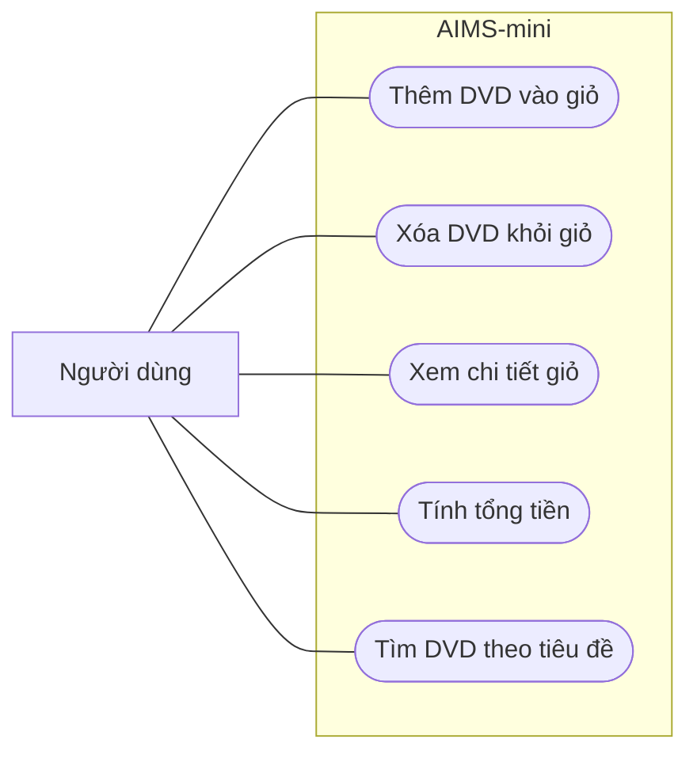

# Use case AIMS-mini

Tác nhân: người dùng chương trình dòng lệnh.

| Chức năng | Đầu vào | Kết quả |
| --- | --- | --- |
| Thêm DVD | Đối tượng DVD | Thêm vào giỏ và thông báo kết quả |
| Xóa DVD | DVD trong giỏ | Xóa đĩa; báo nếu không có |
| Xem giỏ | Giỏ hiện tại | In các DVD và tổng tiền; giỏ trống in `The cart is empty` |
| Tính tổng | Các DVD trong giỏ | Tổng giá DVD; demo là 63.89 USD |
| Tìm theo tiêu đề | Danh sách DVD, từ khóa | Các DVD chứa từ khóa trong tiêu đề, phân biệt hoa thường |

Các chức năng hiện được gọi từ mã Python; main.py minh họa thêm và in giỏ.
Sửa lỗi giới hạn 20 đĩa thuộc Lab 03, tìm không phân biệt hoa thường thuộc Lab 05.
